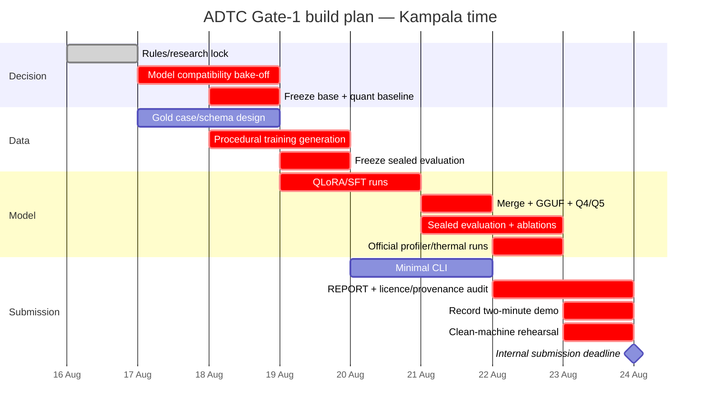

> [!WARNING]
> **Raw material — verbatim capture of chat-delivered text.** Preserved as delivered.
> This is the evidence layer: it is not edited as understanding improves. Decisions
> extracted from it live in `docs/adrs/`; designs live in `docs/rfcs/`. If this document
> and an ADR disagree, the ADR is current and should say what it overrode.
>
> **Redacted for publication**, in two places. In the source text, a sentence in
> §Training-data provenance policy named a current employer while warning against training
> on its data; it now reads "any employer's production data". In the capture metadata
> above, references to an unreleased predecessor product line and to the private archive
> holding the superseded material were genericised, and a wiki-style link that does not
> render here was removed. **No warning, figure, ranking or conclusion changed** — the
> reasoning is as delivered.

> [!CAUTION]
> **What this changes** (added at capture, not part of the source text)
> The 2026-06-28 dossier framed the entry as **education-as-task** with the **Socratic
> Discuss/Viva probe as the knockout demo** and **Gemma-3-4B/1B + Swahili** as locked
> calls. This report **ranks that entry thesis 7th of 9** ("memorable but vulnerable to
> single-shot evaluation") and education-as-task 3rd, replacing both with an **Offline
> Enterprise Exception Analyst** whose flagship is **SLM-led small-packet financial
> reconciliation**. It also drops Swahili from the critical path (the African-use-case
> bonus does not depend on it), opens the base model to a four-way bake-off, and puts
> `joinless` in the founder-credibility story rather than the runtime.

---

# Africa Deep Tech Challenge 2026 Entry Decision: Final Research Report

## Executive summary

### Recommendation

**Choose a hybrid of positions A and B.**

The competition entry should be positioned as:

> **Offline Enterprise Exception Analyst** — an evidence-grounded small language model for sensitive enterprise records, with **SLM-led small-packet financial reconciliation as the flagship capability**.

The decisive refinement is that **the model itself should perform reconciliation when the evidence packet is bounded**. There should be **no external deterministic matcher such as `joinless` in the competition architecture**. `joinless` belongs in the founder/evidence story only: it demonstrates prior experience with record-linkage problems, benchmarking discipline and an understanding of where deterministic methods are strong. This corrects the architecture in the original pitch while preserving the strongest insight behind it.

In practice, the model should be able to receive perhaps **2–20 candidate records plus relevant policy/context**, determine plausible correspondences including simple one-to-many cases, identify unmatched residue, distinguish supported causes from unsupported guesses, cite the evidence behind each finding, and produce an operational disposition. Exact arithmetic and output validation may be performed by ordinary code, but **record correspondence in the bounded packet is an SLM task**. High-volume search across tens of thousands of records is explicitly outside scope.

That produces a much stronger proposition than either candidate alone:

> **The model is an offline enterprise exception analyst. Reconciliation is the flagship task that proves the analyst can do something harder than summarisation.**

The alternatives review was directionally right: reconciliation remains the only candidate in your original sweep with a strong combination of felt pain, confidential data, African applicability, founder credibility and an immediately demonstrable outcome. Education is safer technically but less differentiated; M&E fits your experience but is less immediately legible to judges; procurement comprehension is useful but its source documents are usually public; theOracle has an excellent grounding philosophy but a less visible demonstration; and the Socratic probe is memorable but structurally mismatched to likely single-shot evaluation.

### Why the research strengthens the reconciliation case

Recent industry developments are unusually supportive. BlackLine now markets AI that suggests complex matches, drafts reconciliation items, explains transaction-level variances and summarises supporting evidence while retaining deterministic control layers. Duco combines fuzzy/rule-based matching with AI-powered exception categorisation and, since 2026, predictive labels for unmatched and partially matched reconciliation exceptions while keeping humans in the approval loop. The market is therefore converging on exactly the boundary this entry should claim: **AI is moving deeper into reconciliation, but trust, evidence and human review remain load-bearing.**

Recent small models also make the direct small-packet version substantially more plausible than it was even a year ago. Gemma 3 4B scores 70.1 on Google's FACTS Grounding benchmark versus 36.4 for its 1B sibling; Qwen3.5-4B reports 79.1 on MMLU-Pro and 89.8 on IFEval; Google's new Gemma 4 E2B/E4B models report MMLU-Pro scores of 60.0 and 69.4 respectively. A 2025 4B HalluGuard model reached 84.0% balanced accuracy on a RAGTruth subset for grounded-versus-hallucinated claim assessment, while the 2026 GRACE work explicitly trains evidence sufficiency, support extraction and abstention together. These results do **not** prove that a 4B model can reconcile financial records reliably, but they make it a credible empirical hypothesis rather than wishful thinking.

### Decision in one table

| Question | Position A: Exception Analyst | Position B: SLM-led reconciliation | Recommended hybrid |
|---|---:|---:|---:|
| Strong Corporate/Enterprise breadth | **Excellent** | Moderate | **Excellent** |
| Distinctive competition story | Strong | **Excellent** | **Excellent** |
| Model itself is load-bearing | Strong | **Excellent** | **Excellent** |
| Robust to hidden generic enterprise prompts | **Excellent** | Moderate | **Excellent** |
| Reconciliation pain/demo clarity | Strong | **Excellent** | **Excellent** |
| Technically credible at 4B | **High** | Medium–High for bounded packets | **High** |
| Scales to huge record sets | Not claimed | No | Not claimed |
| Evidence-grounding narrative | **Excellent** | Strong | **Excellent** |
| Judge can ask "why an LLM?" | Answerable | More vulnerable | **Strong answer** |
| Overall competition position | 8.5/10 | 7.5/10 | **9.2/10** |

**My confidence in the hybrid decision is high enough to build against it.** The remaining uncertainty is empirical rather than conceptual: whether the best ~4B GGUF can achieve sufficiently high correspondence accuracy and identifier fidelity under the exact ADTC profiler. That question can be answered with a one-day model bake-off before serious fine-tuning.

---

## Competition rules and the interpretation that should govern the build

### Source hierarchy

Your instinct about DevPost is correct. The safest hierarchy is:

**DevPost Rules → official submission template/current profiler for implementation → challenge microsite/FAQ → forum clarifications.**

DevPost is where the challenge is entered and where the formal eligibility, scoring, submission and prize terms are stated. It therefore should resolve contradictions involving scoring or eligibility. The current official profiler should nevertheless be treated as the implementation contract for anything it actually executes. When the two conflict, **do not optimise for the easier interpretation; engineer to satisfy both.**

The formal DevPost structure gives **50% to accuracy/quality, 30% to throughput and 20% to memory efficiency**, with a thermal penalty and possible disqualification for resource/runtime failures. Its throughput formulation is relative to the maximum observed valid throughput.

The profiler README, by contrast, currently computes throughput as:

`min(TPS / 15, 1) × 100`

and memory efficiency as:

`max(0, (7GB - peak_RSS) / 7GB) × 100`.

It also reports tolerance checks of ±15% for RAM and ±25% for throughput before audit flags, with discrepancies above 50% treated as failures.

**Competition strategy:** treat the 15 TPS cap as a profiler implementation detail, not the governing optimisation target. Assume DevPost's competitive-throughput formula can be applied during judging. Therefore faster remains better.

### Contradiction matrix

| Issue | DevPost / formal position | Other official material | Build interpretation |
|---|---|---|---|
| Throughput | Relative to fastest valid submission | Profiler caps at 15 TPS | **Optimise beyond 15 TPS where possible** |
| Hidden prompts | Accuracy includes unseen evaluation | Template refers to two organiser prompts; FAQ has described three | **Prepare for at least three and broad domain variation** |
| Accuracy | Benchmarks plus qualitative response/documentation assessment | FAQ has at points described judge interaction; profiler currently runs lm-eval | **Optimise both benchmark and open-response ability** |
| App scope | Submission requires project/report/demo | Organiser forum says first round tests only the model | **Model first; minimal real CLI second** |
| Prize naming | DevPost lists third place and African-use-case award | Microsite has used Best Integration/Localisation language | **Use DevPost prize taxonomy; still make integration strong** |
| Language bonus | African-use-case bonus in DevPost | Microsite language/localisation language differs | **African use case does not depend on Swahili** |
| Context | Base models may advertise 32K–262K+ | Current profiler fixes `n_ctx=2048` | **Train compact evidence packets** |

The official template requires an idempotent `download_model.sh`, a GGUF model, two participant prompts in metadata, no credentials to download the model, no model weights committed into the repository, offline operation after download, and a meaningful cross-disciplinary integration.

The organiser has also answered the application/offline ambiguity directly in the DevPost forum: for the first round, **only the model is being tested, and it must work completely offline**. That makes a multi-day frontend build strategically indefensible before Gate 1.

### A crucial profiler discovery

The profiler has changed since a forum participant reported two defects in `v0.1.0`: an invalid local URL and absence of chat-template application. That report still has no organiser response.

The **current** `accuracy.py` no longer uses that failing HTTP route. It now embeds `llama-cpp-python` directly, computes continuation log-probabilities in-process and uses an explicit 2,048-token context. Its default smoke test is a 50-question ARC-Easy subset, while its comments state that the actual audit uses a hidden validation subset. For generation-style tasks, however, it still calls raw `create_completion()` with `temperature=0.0`; there is no chat-template application in that path.

This leads to an important testing rule:

> **The exact final GGUF must be evaluated in four modes: official profiler, raw `llama-cli` completion, chat-template `llama.cpp` interaction, and your CLI application.**

A model that is excellent only when wrapped in its vendor's ideal chat template is unsafe for this competition.

The 2,048-token profiler context also invalidates any model-selection argument based mainly on 128K or 262K context. Long context can help the product later; it does not justify a slower Gate-1 model.

### Deadlines and gates

DevPost currently closes submissions at **11:45 PM PDT on August 24, 2026**, equivalent to approximately **09:45 EAT on August 25 in Kampala**. The published schedule then moves through semifinalist selection, a technical/audit stage and a final live defence on October 17.

The operational rule should be stricter: **treat August 24 EAT as your internal deadline.**

---

## What recent small-model research says about the idea

### The most important finding: four billion parameters is now a serious capability class

The original pitch treated a 3–4B model as largely incapable of arithmetic and implied that 1B versus 4B was mainly an efficiency decision. Recent releases make that too pessimistic.

Gemma 3 demonstrates the size effect particularly clearly:

| Published benchmark | Gemma 3 1B IT | Gemma 3 4B IT | Implication |
|---|---:|---:|---|
| FACTS Grounding | 36.4 | **70.1** | Grounding strongly favours 4B |
| BIG-Bench Hard | 39.1 | **72.2** | Multi-step reasoning strongly favours 4B |
| IFEval | 80.2 | **90.2** | Both follow instructions; 4B stronger |
| MMLU-Pro | 14.7 | **43.6** | 1B loses substantial general capability |
| GSM8K | 62.8 | **89.2** | "4B arithmetic is random" is false |
| Global-MMLU-Lite | 34.2 | **54.5** | Multilingual/general knowledge improves markedly |

Source: Google's Gemma 3 model card.

For this competition, that makes a 1B model useful as the **efficiency baseline**, not my preferred production entry. An Exception Analyst has to compare facts, recognize contradictions, decide when evidence is insufficient and survive unrelated enterprise prompts. Those are precisely the abilities for which the 1B→4B gap is largest.

### The 2026 frontier is much stronger—but runtime maturity matters

Qwen3.5-4B is the most striking candidate on paper. Its official model card reports 4B language-model parameters, 201-language support, a hybrid Gated DeltaNet/attention architecture, Apache-2.0 licensing, 79.1 MMLU-Pro and 89.8 IFEval.

That makes it the **highest-upside model I found for this entry**.

Unfortunately, there is a contest-specific catch: an open `llama.cpp` issue from June 2026 reports that a custom LoRA fine-tune of Qwen3.5-4B, merged to BF16 and converted to a Q5_K_M GGUF, failed because the GGUF path expected 33 blocks while the model contained 32. That is extremely close to the exact workflow you intend to use.

Therefore Qwen3.5-4B should not be rejected—but it gets a **hard two-hour compatibility gate**:

> Fine-tune a tiny LoRA → merge → GGUF → Q4_K_M → run official profiler.

If that succeeds repeatedly on a fresh environment, Qwen3.5 should enter the final bake-off. If not, drop it immediately. Eight days is not enough to become a `llama.cpp` architecture maintainer.

Gemma 4 creates a similar trade-off. Google's E2B and E4B models are impressive: E2B reports 60.0 MMLU-Pro and E4B 69.4; both are explicitly designed for on-device operation and are Apache-2.0 licensed. But Google's "effective" parameter names hide large per-layer embedding tables: E2B is 5.1B total parameters with embeddings, and E4B is 8B total.

More importantly, recent `llama.cpp` issues have covered PLE implementation, E4B regressions and MTP problems. One quantisation report also showed E2B perplexity rising from 8.32 BF16 to 8.51 at Q5_K_M, 9.14 at Q4_K_M and 12.69 at Q3_K_M, with more severe degradation reported for E4B after a threshold. These are community issue measurements rather than an official benchmark, but they are enough to make Gemma 4 a risky deadline bet.

### Practical model shortlist

| Candidate | Size class | Strength | Main risk | Recommendation |
|---|---:|---|---|---|
| **Qwen3.5-4B** | ~4B LM | Exceptional published capability, Apache 2.0 | Current fine-tuned GGUF conversion issue | **High-upside bake-off; use only if conversion passes immediately** |
| **Qwen3-4B** | 4B | Mature, multilingual, Apache 2.0, official local/`llama.cpp` guidance | Thinking/chat-template behaviour; raw-profiler tests mandatory | **Primary stable candidate** |
| **Gemma 3 4B** | 4B | Excellent grounding/IFEval; mature | Older and lower general benchmarks; Gemma licence | **Strong control candidate** |
| **Phi-4-mini** | 3.8B | Microsoft reports strong reasoning/math/coding at compact size | Less obviously differentiated for grounding | **Third bake-off candidate** |
| **Gemma 4 E2B** | 5.1B total incl. embeddings | 2026 capability; on-device design | Runtime/quantisation maturity | Experimental only |
| **Gemma 4 E4B** | 8B total incl. embeddings | Very strong | Memory-score cost + runtime maturity | Do not bet Gate 1 on it |
| **1–2B baseline** | 1–2B | Excellent memory/TPS | Substantial reasoning/grounding loss | Efficiency control/fallback |

Qwen3's official release includes 0.6B, 1.7B, 4B and larger dense/MoE variants, with 100+ languages and explicit support for local frameworks including `llama.cpp`. Its hybrid thinking/non-thinking design is powerful, although the model card warns that optimal reasoning settings depend on the chat template and sampling configuration—another reason to test the profiler's raw/greedy path rather than extrapolating from online benchmarks.

Microsoft's Phi-4-mini is 3.8B parameters; its technical report describes a deliberate emphasis on high-quality synthetic reasoning data, multilingual support and strong performance relative to similarly sized models. It belongs in the bake-off even if it does not win it.

### What the numerical-reasoning research really says

There are two simultaneous truths.

First, compact modern models can perform substantial mathematical reasoning. Gemma 3 4B's published GSM8K result of 89.2 makes the original claim that 3–4B models are "close to random" on arithmetic untenable.

Second, **financial-grade numerical fidelity remains a bad thing to entrust to free-form generation**. Research into internal number representation finds that language models often represent numbers digit-by-digit rather than as a single numeric magnitude, helping explain errors even in apparently simple numerical comparisons. Other work explicitly modifies number encodings to improve arithmetic, which itself demonstrates that ordinary tokenisation is not a reliable calculator interface.

Therefore the revised architectural claim should not be:

> "The model cannot do maths."

It should be:

> **"The model can reason about numbers, but financial arithmetic and output validation are deterministic because there is no reason to accept probabilistic error where exact computation is available."**

That is much harder for a judge to attack.

### Grounding and abstention are trainable SLM behaviours

This is the area where recent research most strongly supports position A.

HalluGuard demonstrates that a 4B model can be specialised to assess whether claims are supported by evidence, achieving 84% balanced accuracy on the RAGTruth subset it reports while providing evidence-grounded justifications.

GRACE goes further: its training objective jointly teaches a model to evaluate **evidence sufficiency**, extract supporting evidence, answer when support exists and explicitly abstain when it does not.

A separate 2026 GRACE benchmark on step-level faithful reasoning finds that reasoning traces can deviate from evidence even when the final answer is correct, reinforcing the need to score evidence faithfulness independently of answer correctness.

This suggests a training recipe considerably better than "fine-tune it to produce reconciliation explanations":

**Every reconciliation family should contain positive, ambiguous, contradictory and unanswerable variants.**

For example:

> **Supported:** fee difference + tariff explicitly states the fee → classify fee deduction.

> **Unsupported:** same difference, no tariff or settlement breakdown → `CAUSE_NOT_ESTABLISHED`.

> **Contradictory:** settlement report says fee; reversal log states reversal → `CONFLICTING_EVIDENCE`.

> **Partial:** correspondence is likely but the cause is unknown → match may be stated separately from cause.

The fine-tune should punish a plausible invented cause more severely than an abstention.

### Memory, throughput and accuracy

The following chart uses **published MMLU-Pro values** and a deliberately simplified 4.8-bit-per-parameter Q4 weight-only footprint. Marker size is merely an inverse-weight throughput proxy; it is **not measured ADTC TPS**. Gemma 4 is plotted using Google's total parameter count including per-layer embeddings, while Qwen3.5 uses its language-model parameter count. Exact GGUF RSS must be measured.

*(Chart reference `adtc_model_tradeoff.png` did not survive capture — see frontmatter.)*

The chart's most useful conclusion is not "Qwen3.5 wins". It is:

> **The modern 4B band is dramatically more capable than the 1B band while remaining plausibly comfortable under the 7GB ceiling. Start there.**

---

## Reconciliation market, architecture and feasibility

### Existing systems validate the pain—but also warn against the wrong architecture

BlackLine describes its high-volume transaction-matching system as ingesting and transforming records from banks, ERPs, payroll, procurement and other systems, then applying configurable rules to automatically match records and surface exceptions. Its newer Verity AI layer moves further: Verity Match handles scenarios beyond traditional rules, Verity Prepare drafts reconciling items, Verity Flux generates transaction-level variance explanations, and Verity Summarize handles supporting documents.

Duco tells a similar story. Its reconciliation product combines fuzzy matching, tolerances and user-managed rules with AI-powered rule setup and automated exception management. It supports one-to-many and many-to-many manual matching. Its 2026 Predictive Labelling feature trains environment-specific models on prior human exception labels and only deploys predictions after reaching its stated 90% accuracy threshold; humans remain responsible for review and application.

This tells us two things.

**First, the pain is absolutely real.** Enterprise vendors sell expensive products explicitly around transaction matching, exception ownership, investigation and "why did these balances move?" analysis. Reconciliation was not merely your payments-work bias.

**Second, incumbents do not generally treat a generative model as the unconstrained bulk-matching engine.** They combine structured matching/control systems with increasingly capable AI around ambiguous matching and exceptions. That argues against claiming that your 4B model should search 100,000×100,000 combinations. It does **not** argue against SLM-led reconciliation in a bounded candidate packet.

The entry's novelty is therefore not "AI has never been used for reconciliation". That claim is now demonstrably false.

The defensible differentiator is:

> **A compact, open, CPU-local reconciliation and exception model designed to operate entirely offline on ordinary hardware, with evidence sufficiency and abstention treated as first-class behaviours.**

That is substantially more specific and more defensible.

### What SLM-led reconciliation can realistically mean

Position B becomes viable when "reconciliation" is scoped correctly.

**In scope**

- 2–20 records across two sides.
- One-to-one correspondence.
- One-to-many and many-to-one cases.
- Misspelled names.
- Mangled references.
- Timestamp/cut-off differences.
- Fees or withholding described in evidence.
- Reversals and duplicates.
- Partial payments.
- Batched versus itemised transactions.
- Missing records.
- Cause classification from supplied policy/context.
- Explicit ambiguous/no-match conclusions.

**Out of scope**

- brute-force candidate search over millions of rows;
- maintaining a general ledger;
- unconstrained many-to-many optimisation at large scale;
- fraud attribution;
- unsourced causal claims;
- autonomous posting of adjustments;
- relying on generation for authoritative arithmetic.

That is still **real reconciliation**. It simply makes the SLM responsible for the human-like adjudication step rather than pretending a language model is a database join operator.

### Recommended architecture

```text
                     LOCAL / OFFLINE
                           │
                 ┌─────────▼─────────┐
                 │ Input case packet │
                 │ CSV / text / docs │
                 └─────────┬─────────┘
                           │
               deterministic parsing only
                           │
                stable source / record IDs
                           │
                 ┌─────────▼─────────┐
                 │   Fine-tuned SLM   │
                 │                    │
                 │ • correspondence   │
                 │ • contradiction    │
                 │ • exception cause  │
                 │ • evidence support │
                 │ • abstention       │
                 │ • disposition      │
                 └─────────┬─────────┘
                           │
                    structured JSON
                           │
             ┌─────────────▼─────────────┐
             │ Deterministic validator    │
             │ • cited IDs actually exist│
             │ • quoted numbers exist    │
             │ • exact arithmetic        │
             │ • schema validity          │
             └─────────────┬─────────────┘
                           │
                 audit-ready report
                           │
                 ┌─────────▼─────────┐
                 │ Human authorises   │
                 └────────────────────┘
```

**No deterministic matcher exists in this architecture.**

That matters. The model is the component that decides correspondence in the supplied packet.

The validator is not a dodge. It is analogous to type-checking model output: it cannot invent a match the model failed to identify. It only guarantees that exact, machine-verifiable claims are not silently corrupted.

### Recommended output contract

A compact structured output could resemble:

```json
{
  "matches": [
    {
      "left": ["A-017"],
      "right": ["B-004"],
      "status": "supported",
      "evidence": [
        "same amount: UGX 248000",
        "reference fragment: TX4931",
        "counterparty alias: Kato Supplies"
      ]
    }
  ],
  "unmatched": ["A-019"],
  "exceptions": [
    {
      "records": ["A-017", "B-004"],
      "type": "fee_deducted_at_source",
      "support": ["POLICY-02:L7-L9"],
      "certainty": "supported"
    }
  ],
  "unknowns": [
    {
      "records": ["A-019"],
      "reason": "cause_not_established",
      "required_evidence": "processor settlement breakdown"
    }
  ],
  "disposition": [
    "Accept A-017/B-004 as corresponding records.",
    "Hold A-019 for settlement-report review."
  ]
}
```

Do **not** train numerical probability scores such as `"confidence": 0.87` unless they are calibrated. Categorical states—`supported`, `ambiguous`, `unsupported`—are much easier to evaluate honestly.

### Provenance without a heavyweight RAG stack

For Gate 1, I would avoid a vector database entirely. The official profiler's 2,048-token context and the first-round model-centric judging make a complex retrieval subsystem poor use of time.

Instead, use a minimal provenance scheme:

```text
DOC-01
  REC-01
  REC-02

DOC-02
  REC-03

POLICY-01
  P01
  P02
```

Every generated conclusion references those immutable IDs. The validator checks the references and stores a lightweight evidence graph. W3C PROV's concepts of entities, activities, derivation and attribution provide a recognised conceptual basis if you want to formalise this later, but Gate 1 does not need an RDF stack.

EmbeddingGemma or a similar local embedding model could later support large local evidence collections; Google's model card explicitly positions EmbeddingGemma for retrieval, similarity, classification and clustering. It is not needed for the first submission.

### Cross-disciplinary integration

Without `joinless`, the best declared integration is:

> **Small language modelling × financial control/audit methodology × evidence provenance.**

The accounting-control side is load-bearing:

- correspondence must be traceable;
- exceptions remain open until disposition;
- unsupported causes are not treated as facts;
- consequential actions require human approval;
- exact values are verified against source evidence.

The provenance side is load-bearing:

- each finding names its source record;
- extracted numbers can be checked;
- the final disposition can be reconstructed from the evidence packet.

That is considerably stronger than attaching an unrelated discipline to satisfy a metadata field.

### `joinless` belongs in the founder evidence, not the runtime

Your prior material used `joinless` as the deterministic matcher and as evidence from a sealed matching benchmark.

Given your clarification, the report should instead say something like:

> **Prior work:** The project lead previously built and benchmarked a separate keyless record-linkage system. That work is not part of this submission's runtime architecture; it informed the decision to evaluate correspondence independently from explanation, preserve deterministic validation, and publish uncomfortable benchmark results rather than hide them.

That is powerful founder credibility without creating the "the model doesn't actually reconcile anything" attack.

Your alternatives document already shows that unified payment reconciliation was not an improvised competition idea but part of a longer product thesis.

---

## Model, quantisation and sealed evaluation strategy

### Size and quantisation decision

The right starting point is **4B at Q4_K_M**, not Q5_K_M by default.

Why Q4 first? Because DevPost's throughput remains competitive and every additional gigabyte of peak RSS has a direct score cost. The profiler itself supports the same basic memory formula.

Using DevPost's memory formula:

| Peak RSS | Efficiency score | Contribution to total score |
|---:|---:|---:|
| 2 GB | 71.4 | 14.29 points |
| 3 GB | 57.1 | 11.43 points |
| 4 GB | 42.9 | 8.57 points |
| 5 GB | 28.6 | 5.71 points |
| 6 GB | 14.3 | 2.86 points |
| 7 GB | 0 | 0 points |

Assuming equal throughput and no thermal difference, **each additional 1GB of RAM costs about 2.86 total competition points**. Because raw accuracy has a 0.50 weight, a larger configuration needs approximately **5.71 additional raw accuracy points per extra gigabyte** merely to compensate.

*(Chart reference `adtc_memory_score_sensitivity.png` did not survive capture — see frontmatter.)*

Therefore:

> **Q4_K_M is the baseline. Q5_K_M wins only if the sealed evaluation demonstrates an accuracy/fidelity gain large enough to pay for its RAM and TPS cost.**

Q6 should be a diagnostic, not an assumed submission format. Q3 should only be considered for a small efficiency model; the Gemma 4 quantisation measurements provide a useful warning that aggressive quantisation can meaningfully degrade some newer architectures.

### Hard memory target

Do not design to 6.8GB.

The profiler expressly anticipates audit variance between local and official environments.

Use:

> **Gate-1 target peak RSS ≤ 5.0GB. Preferred ≤ 4.0GB.**

That gives operating-system and audit headroom while preserving actual memory-score points.

### Bake-off sequence

Run the following **before generating the full training set**:

| Order | Model | Q4 test | Fine-tune→GGUF test | Reason |
|---:|---|---|---|---|
| 1 | Qwen3.5-4B | Yes | **Mandatory** | Highest upside, known conversion risk |
| 2 | Qwen3-4B / suitable Instruct checkpoint | Yes | Yes | Mature Apache candidate |
| 3 | Gemma 3 4B | Yes | Yes | Grounding-oriented control |
| 4 | Phi-4-mini | Yes | Yes | Architecture/vendor diversity |
| 5 | 1–2B baseline | Yes | Optional | Quantifies efficiency frontier |

Freeze the primary model based on the **quantised GGUF**, never the BF16 checkpoint.

### Training set

The fine-tune should be broader than reconciliation but not generic.

A reasonable Gate-1 mix is:

| Training family | Share | Purpose |
|---|---:|---|
| Small-packet correspondence | 25% | Gives B its real capability |
| Exception/cause adjudication | 20% | Core reconciliation reasoning |
| Insufficient/conflicting evidence | 15% | Abstention and trust |
| Cross-document comparison | 10% | Enterprise breadth |
| Policy/terms QA | 10% | Hidden-prompt robustness |
| Business summarisation | 10% | Corporate/Enterprise breadth |
| Operational memo/action drafting | 10% | Corporate/Enterprise breadth |

A workable planning range is **8,000–15,000 high-quality SFT examples**, with **300–500 carefully designed gold templates/cases** expanded procedurally. A 4B QLoRA run at 1–2 epochs and approximately 1,024–1,536 training tokens per example should be treated as roughly a **few GPU-hours**, not as a multi-day pretraining exercise; exact time depends heavily on the GPU and framework. The organisers currently advertise limited participant GPU credits for training experimentation, while final benchmarking must still run on the standard laptop profile.

Do not use a teacher to manufacture plausible explanations without verification. The most valuable synthetic data here is **procedural ground truth**: you know exactly what transformation created the discrepancy.

### Reconciliation perturbation families

Build the sealed suite around explicit mechanisms:

| Family | Example | Correct model behaviour |
|---|---|---|
| Exact match | Same amount/reference | Match |
| Reference corruption | `TX-09831` → `T09831` | Match from combined evidence |
| Name alias | `ABC Trading Ltd` / `ABC TRADERS` | Match if other evidence supports |
| Timing drift | Day+1 settlement | Match where policy supports timing |
| Fee deduction | Gross vs net | Match + classify only with tariff/support |
| Partial payment | Invoice 500k / payment 300k | Partial relation |
| Split payment | One obligation / two payments | One-to-many |
| Batch settlement | Several items / single settlement | Many-to-one |
| Reversal | Original + reversal pair | Lifecycle exception |
| Duplicate | Same event posted twice | Duplicate candidate |
| Missing record | Only one side exists | Unmatched |
| Ambiguous | Two equally plausible candidates | **Abstain** |
| Unsupported cause | Difference exists, no explanation | **Cause not established** |
| Contradictory evidence | Policy/logs disagree | **Conflicting evidence** |
| Adversarial identifier | Near-identical long references | Preserve exact characters |

### Sealed test design

Use a **grouped split**, not random row splitting.

The sealed set should contain at least ~1,000 cases if procedural generation makes that practical:

| Slice | Cases | Primary measurement |
|---|---:|---|
| Correspondence packets | 350 | Match precision/recall/F1 |
| Cause + exception analysis | 200 | Macro F1 |
| Abstention/ambiguity | 150 | Selective accuracy/risk |
| Generic enterprise documents | 150 | Hidden-prompt resilience |
| Identifier/value fidelity | 75 | Exact match |
| Adversarial/noisy packets | 75 | Robustness |

Keep whole perturbation templates, institutional layouts and reference-generation families isolated between train and sealed test. Otherwise a synthetic benchmark can give you an extremely convincing but meaningless score.

### Metrics mapped to DevPost scoring and judge attacks

| Metric | Target before submit | DevPost relevance | Judge attack it answers |
|---|---:|---|---|
| Official profiler accuracy | Beat untuned base; no regression | **Accuracy 50%** | "Did the fine-tune improve the actual judged model?" |
| Generic enterprise task score | ≥95% of base capability | **Accuracy 50%** | "Did you destroy general Corporate/Enterprise ability?" |
| Correspondence F1 | **≥0.90 target; ≥0.85 minimum** | Quality | "Can it actually reconcile?" |
| Ambiguous-case false-match rate | **<5% target** | Quality | "Does it force a match when it should stop?" |
| Cause macro F1 | ≥0.85 target | Quality | "Is the explanation more than fluent prose?" |
| Unsupported-cause hallucination rate | **<3% target** | Quality | "Will it make up why money is missing?" |
| Correct abstention rate | ≥90% | Quality | "Does it know what it doesn't know?" |
| Evidence citation precision | ≥98% | Quality/docs | "Can I audit its answer?" |
| Amount/reference/date exact-copy rate | **≥99.5%** | Quality | "Can I trust financial identifiers?" |
| Structured-output parse rate | ≥99% | Quality | "Can software consume it reliably?" |
| Q4 vs Q5 delta | Measured | Accuracy/RAM/TPS | "Why this quantisation?" |
| Generation TPS | Maximise; do not stop at 15 | **Throughput 30%** | "Why isn't a 1B model strategically better?" |
| Peak RSS | **≤5GB hard internal; ≤4GB preferred** | **Memory 20%** | "Where is the safety margin?" |
| Thermal/throttling | No sustained > threshold event | Penalty | "Did you benchmark a cold machine only?" |
| Three-run variance | Low | Gate-2 reproducibility | "Can we reproduce your numbers?" |

The targets above are **go/no-go engineering thresholds**, not organiser requirements.

### The ablation that will make the report credible

Run the same sealed set against:

1. **Untuned base GGUF**
2. **Fine-tuned GGUF Q4_K_M**
3. **Fine-tuned GGUF Q5_K_M**
4. Optionally, the 1–2B efficiency baseline

Then report:

```text
                        Base       FT-Q4       FT-Q5
Profiler benchmark       ...
Recon match F1           ...
Abstention                ...
Grounding                 ...
Identifier fidelity       ...
TPS                       ...
Peak RSS                  ...
```

This single table proves:

- what fine-tuning bought;
- what quantisation destroyed or preserved;
- why the chosen model size is rational;
- whether specialised training damaged the general model.

That is much stronger than simply publishing the final score.

---

## Gate plan, CLI, timeline and resources

### Minimal CLI demonstration

Do not build a web application before Gate 1.

Build:

```bash
local-recon analyse case.json \
  --model ./model/submission.gguf \
  --output result.json
```

Input:

```text
case.json
├── records_a[]
├── records_b[]
├── policy_evidence[]
└── notes[]
```

Terminal output:

```text
LOCAL ENTERPRISE EXCEPTION ANALYST
Network: OFFLINE
Model: submission-Q4_K_M.gguf

MATCHES
A17 → B04     SUPPORTED
Evidence: amount, reference fragment, counterparty

EXCEPTIONS
A17/B04       FEE_DEDUCTED_AT_SOURCE
Support: POLICY-02:L7-L9

UNRESOLVED
A19           CAUSE_NOT_ESTABLISHED
Needed: processor settlement breakdown

VALIDATION
✓ All referenced record IDs exist
✓ All quoted amounts occur in evidence
✓ Output schema valid

PERFORMANCE
TPS: ...
Peak RSS: ...
```

For the two-minute video:

1. Show airplane mode/network disabled.
2. Show a small Ugandan-style payment/procurement case.
3. Run the model.
4. Point to a non-obvious match.
5. Point to one supported exception.
6. Most importantly, show **one case where the model refuses to invent a cause**.
7. Display TPS and RAM.
8. Finish with the one-line architectural claim.

That is a better demo than showing 200 automatically matched rows. The judge needs to see intelligence, not volume.

### Gate deliverables

| Gate | Required preparation |
|---|---|
| **Gate 1** | Public repo based on template; correct metadata; exact two participant prompts; idempotent public `download_model.sh`; final GGUF; full profiler result; `REPORT.md`; setup/run instructions; screenshots/clips; ≤2-minute demonstration; model/data licences and attribution; African-use-case claim. |
| **Gate 2** | Reproduce final commit in clean environment; profiler audit tolerance; 30-minute technical defence; training-data manifest; sealed test methodology; Q4/Q5/base ablations; architecture boundaries; known failures; optional concise technical response/updated benchmark material where permitted. |
| **Gate 3** | Max-10-slide live defence according to challenge guidance; fully local demo; backup command sequence; exact hardware measurements; technical setup verification; defend model choice, reconciliation scope, abstention and market relevance. |

The formal submission requirements and early-stage eligibility come from DevPost; the microsite describes the subsequent reproducibility and live-defence structure, while the organiser forum confirms that round one primarily tests the model.

### Build timeline



### Daily decision gates

**August 17:** Qwen3.5 fine-tune-to-GGUF works in current `llama.cpp`, or it is removed.

**August 18:** one 4B model is frozen as primary and one model as fallback.

**August 19:** output schema, training taxonomy and sealed-test generator are frozen.

**August 21:** first Q4 fine-tuned GGUF exists. From this point, stop architectural experimentation.

**August 22:** go/no-go based on sealed thresholds, profiler TPS/RSS and raw-completion behaviour.

**August 23:** only report, CLI, demo, reproducibility and critical bug fixes.

**August 24:** submit; do not use the Kampala-equivalent August 25 morning as normal working time.

### Resource estimate

| Resource | Practical budget |
|---|---|
| Project lead engineering | ~55–70 focused hours through internal deadline |
| Gold case design | 300–500 scenario/template seeds |
| SFT examples | 8k–15k after procedural expansion |
| Sealed cases | ~1,000 |
| 4B training | Plan 2–6 GPU-hours per serious run; cap serious runs at 2–3 |
| Final quantisations | Q4_K_M + Q5_K_M, optional Q6 diagnostic |
| Base models carried to final comparison | Maximum 3 after initial bake-off |
| CLI | <1 engineer-day |
| Video | 2–3 hours including rehearsal |
| Report/reproducibility | 1–1.5 days |
| Target final RSS | ≤5GB; preferred ≤4GB |
| Target model count at submission | Exactly one GGUF |

The organiser currently offers a limited pool of up to five GPU-credit hours for participant experimentation, subject to availability/approval; treat that as a bonus rather than a dependency.

---

## Legal, licensing and risk register

### Participation Agreement: explicitly unresolved

DevPost requires entrants to agree to the separate Challenge Participation Agreement.

**The exact Participation Agreement text remains unspecified in this research because I could not reliably retrieve its full contents from the linked Google document. It must therefore be treated as an unresolved pre-submission legal dependency, not inferred.**

Before submitting, manually verify at minimum:

- ownership of the fine-tuned model and adapters;
- whether organisers receive a licence to weights/code/data;
- whether that licence is exclusive or non-exclusive;
- sublicensing rights;
- publicity/demo rights;
- training-data warranties;
- open-source obligations;
- representations concerning third-party IP;
- indemnities and limitation of liability;
- prize eligibility/payment conditions;
- residency obligations;
- right to disqualify or retain submitted artefacts;
- confidentiality treatment;
- governing law and dispute provisions.

Do not tick the agreement and discover the IP terms afterwards.

### Base-model licensing

Licensing should influence the model bake-off, though not override performance.

Qwen3 and Qwen3.5 model cards identify Apache-2.0 licensing. Gemma 4 is also Apache-2.0 according to Google's 2026 model card.

Gemma 3 uses the Gemma licensing regime rather than the new Gemma 4 Apache model, so its notices and redistribution requirements should be reviewed separately if it wins the bake-off.

The official ADTC template itself is GPL-3.0. That does **not** mean "everything in the repository, model weights and training corpus automatically becomes GPL"; document code, model and dataset licences separately and preserve all upstream notices.

For Phi-4-mini, verify the licence attached to the **exact checkpoint you download**, not merely the Microsoft paper describing the architecture. Microsoft confirms the 3.8B model and technical approach, but checkpoint licence compliance should be recorded from the chosen distribution artefact.

### Training-data provenance policy

Create `DATA_PROVENANCE.md` containing one row per dataset/generator:

| Field | Required |
|---|---|
| Dataset/generator name | Yes |
| Origin | Yes |
| Licence/permission | Yes |
| Acquisition date | Yes |
| Contains real personal data? | Must be no unless explicitly justified |
| Synthetic-generation mechanism | Yes |
| Teacher/checkpoint and licence | If applicable |
| Transformations | Yes |
| Train/eval allocation | Yes |
| Content hash/version | Yes |
| Known restrictions | Yes |

The safest corpus is:

> **procedurally generated financial cases + hand-authored enterprise instructions + clearly licensed/open examples + real public documents used only where their reuse terms have been checked.**

"Publicly visible" does not mean "unrestricted training licence".

Do not use any employer's production data, SACCO member records, customer ledgers or any other real confidential material merely because it would make the cases realistic.

### Privacy framing

Uganda's Personal Data Protection Office is the authority responsible for implementing and enforcing the Data Protection and Privacy Act.

The competition pitch should **not** say:

> "Offline is the only lawful architecture."

Instead:

> **"Offline inference removes a major disclosure and external-processing dependency for workflows involving sensitive enterprise and financial records, while leaving ordinary access-control, retention, audit and data-protection obligations intact."**

That is both stronger legally and harder to embarrass in a Q&A.

### Risk register

| Risk | P | Impact | Mitigation / kill criterion |
|---|---|---|---|
| Qwen3.5 fine-tuned GGUF fails in `llama.cpp` | High | Critical | Two-hour conversion test; drop immediately if unstable. |
| DevPost/profiler throughput interpretation differs | High | High | Optimise relative TPS, not merely 15 TPS. |
| Hidden prompt count/type differs | High | High | Train broad Corporate/Enterprise skills; assume ≥3 unknowns. |
| Chat-template/raw completion mismatch | High | Critical | Test official profiler + raw completion + chat mode. |
| Fine-tune harms general benchmark ability | Medium | High | Base-vs-FT ablation; reject >5% general-capability deterioration unless domain gain is exceptional. |
| Model incorrectly matches ambiguous records | Medium | Critical | Train explicit ambiguous cases; false-match target <5%. |
| Model invents discrepancy cause | Medium | Critical | Unanswerable/contradictory training; support-required schema; abstention metric. |
| Long identifiers mutate | High | High | Exact-copy suite; deterministic output validation; no generated arithmetic. |
| Q5 gives better quality but loses competition score | Medium | Medium | Choose from measured score frontier, not intuition. |
| Peak RAM varies at audit | Medium | Critical | Internal hard target ≤5GB; three-run cold/warm measurements. |
| Thermal throttling | Medium | High | 10–15 minute repeated benchmark, plugged/unplugged documented. |
| Training-data licence unclear | Medium | Critical | Provenance manifest; exclude uncertain source. |
| Participation Agreement contains problematic IP term | Unknown | Critical | Manual legal read before upload. |
| Reconciliation story becomes too narrow | Medium | High | Position model as Exception Analyst; keep enterprise breadth. |
| Model does not reach ≥0.85 small-packet F1 | Medium | High | Fall back to A-only positioning: exception analysis with correspondence supplied in prompt. |
| Time runs out | High | Critical | Model/data/eval first; no GUI; no Swahili unless already verified. |

That penultimate risk is important because it gives you an elegant fallback:

> If SLM-led matching empirically disappoints, you do **not** throw the project away. You remove direct correspondence from the headline and ship the same fine-tuned model as an evidence-grounded Enterprise Exception Analyst.

---

## Final decision and auditable research record

### The final position

I would now lock the concept at:

> ## **Offline Enterprise Exception Analyst**
>
> **A compact offline model that reconciles small packets of conflicting enterprise records, identifies supported exceptions and missing evidence, and produces traceable operational dispositions without sending sensitive source data to a hosted model.**

The flagship demonstration is:

> **Procurement/payment reconciliation on a Ugandan enterprise case packet.**

The flagship model behaviour is:

> **SLM-led correspondence + evidence-grounded exception adjudication + abstention.**

The application boundary is:

> **Parsing and verification are deterministic. Correspondence and interpretation in the bounded packet are model-led. Human beings authorise consequential actions.**

And the boundary sentence I would use in the live defence is:

> **"We don't use a language model where exact software is already perfect. We use it where reconciliation turns into evidence judgement."**

That is materially stronger than the original:

> "Code computes. The model explains."

"Explains" sounded cosmetic. **"Evidence judgement"** gives the model a load-bearing job.

### Why the hybrid beats A alone

A pure Exception Analyst would almost certainly work, but it risks becoming another document-grounded business assistant. The competition already encourages Corporate/Enterprise summarisation, drafting and analysis; many entrants can plausibly offer that.

Direct small-packet reconciliation gives you the differentiator:

> "Here are two inconsistent records. Tell me whether they describe the same economic event—and tell me when there isn't enough evidence to know."

That is a harder, more memorable test.

Recent small-model progress makes that experiment credible.

### Why the hybrid beats B alone

A model called an "SLM Reconciliation Engine" immediately invites:

- How does it scale?
- Why not rules?
- Can it add?
- What about many-to-many optimisation?
- What happens with 500,000 rows?
- Why should I trust a generative system with a ledger?

You would spend the Q&A defending things the entry never needed to claim.

"Enterprise Exception Analyst" gives the correct umbrella. Reconciliation then proves depth rather than imposing an unrealistic product boundary.

### Why reconciliation still beats the alternatives

After the broader review, my ordering is:

| Rank | Entry thesis | Final assessment |
|---:|---|---|
| **1** | **Exception Analyst + SLM-led bounded reconciliation** | Best combination of judging fit, differentiation, founder credibility, privacy relevance and technical plausibility |
| 2 | Pure Exception Analyst | Safest fallback; somewhat generic |
| 3 | Education document transformation | Lowest technical risk; weaker reason for on-device deployment and weaker differentiation |
| 4 | M&E analyst | Excellent founder fit; problem requires more explanation |
| 5 | theOracle/public-record correlation | Strong epistemic design; weaker live demonstration and retrieval dependency |
| 6 | Procurement/tender comprehension | Useful but public-source/offline argument weak |
| 7 | Socratic understanding probe | Memorable but vulnerable to single-shot evaluation |
| 8 | Invoice-only reconciliation | Too narrow for hidden prompts |
| 9 | Generic SME copilot | Broad but undifferentiated |

This mostly preserves the conclusion of your alternatives sweep while correcting one assumption: **offline necessity should not outrank the actual 50/30/20 model score.**

### The empirical decision rule

Do not debate A versus B again after August 19.

Let one experiment decide it.

Create **200 completely sealed reconciliation packets** before fine-tuning, spanning direct, fuzzy, split, batched, ambiguous and unsupported cases.

Then run the final quantised model.

**Ship the hybrid headline if:**

- correspondence F1 ≥ 0.90, or at minimum ≥0.85 with exceptional abstention;
- ambiguous false-match rate <5%;
- exact identifier fidelity ≥99.5%;
- unsupported-cause hallucinations <3%;
- general enterprise score remains ≥95% of the untuned model;
- RSS ≤5GB;
- profiler/runtime is stable.

**Fall back to pure A if direct correspondence fails those thresholds.**

That is the closest viable route to making reconciliation real without gambling the whole challenge on it.

### Decision audit trail

| Observation from research | Implication | Decision |
|---|---|---|
| DevPost gives half the score to accuracy/quality. | A narrow specialised model cannot trade away general quality cheaply. | Preserve broad enterprise skills. |
| DevPost and profiler conflict on TPS. | 15 TPS cannot safely be treated as "done". | Optimise Q4 and relative speed. |
| Profiler uses only 2,048 context. | Huge advertised context is not a Gate-1 advantage. | Use compact packets. |
| Current generation adapter uses raw completion. | Chat-template-dependent models can surprise you. | Dual-mode testing is mandatory. |
| 4B grounding/reasoning improved sharply versus 1B. | 4B is probably worth the memory cost. | Start in 3.8–4B band. |
| Qwen3.5-4B has exceptional published scores. | Potential accuracy advantage. | Include in bake-off. |
| Qwen3.5 custom-LoRA GGUF conversion currently has an open issue. | Deadline/runtime risk may dominate benchmark gain. | Kill quickly if conversion is unstable. |
| New Gemma 4 edge models have strong scores but young llama.cpp support. | Interesting after Gate 1, dangerous as sole plan. | Experimental only. |
| Small models can be trained for grounding/abstention. | Hallucination control can be a trained capability. | Make support/abstention core data classes. |
| Numerical representation remains error-prone. | Do not rely on generation for authoritative arithmetic. | Deterministic validation stays. |
| BlackLine/Duco increasingly apply AI to complex matches and exception work. | Reconciliation + AI is market-valid, but "nobody does this" is false. | Differentiate on compact offline deployment and evidence sufficiency. |
| Incumbents retain controls/human review. | Autonomous ledger action is the wrong claim. | Human authorisation explicit. |
| Round one primarily tests the model. | Product polish has poor immediate ROI. | CLI only. |
| Prior `joinless` work demonstrates matching experience but is not needed for the entry. | It strengthens founder credibility but weakens model ownership if used as runtime matcher. | Reference only; no dependency. |

### Forum and DevPost discussion highlights

The currently visible DevPost discussions contain three material signals.

The **offline-app clarification** received an organiser-manager answer: the first round tests the model and the model must operate completely offline. This validates the model-first/CLI-minimal strategy.

The **profiler bug report** documented an older `v0.1.0` invalid-URL problem and warned that instruct models were being evaluated without chat templates; it has no organiser response. The current source has replaced the invalid-URL implementation, so that part of the report is superseded, but the current generation path is still raw completion.

The DevPost discussion index also contains an **eligibility thread concerning a developer with unrelated existing products**, reinforcing that participants are actively testing the early-stage-project boundary. The formal rule remains that the submitted venture/project must itself satisfy the challenge's age, stage and funding requirements.

### Primary and research source record

The findings above are principally grounded in:

**Competition:** DevPost formal rules and schedule; the official ADTC profiler and current `accuracy.py`; the official submission template; the challenge microsite/FAQ; and organiser/forum discussions.

**Small models:** Google Gemma 3 and Gemma 4 official model cards; Qwen/Qwen3 and Qwen3.5 official repositories/model cards; Microsoft's Phi-4-mini technical report; and current `llama.cpp` compatibility/quantisation issue reports.

**Grounding/numerics:** GRACE, HalluGuard, numerical-representation research and the W3C PROV recommendation.

**Reconciliation market:** BlackLine Transaction Matching/Verity and Duco reconciliation, manual matching, exception-management and predictive-labelling documentation.

**Internal decision material:** the original reconciliation pitch and alternatives sweep, used here as the baseline hypothesis rather than treated as evidence for external factual claims.

### Final hand-off brief

For an independent reviewer analysing this decision, the proposition to challenge is:

> **ADTC 2026 entry hypothesis:** Fine-tune a ~4B GGUF model into an Offline Enterprise Exception Analyst. It must retain broad Corporate/Enterprise summarisation, extraction, policy-QA and drafting capability, while adding direct small-packet reconciliation: correspondence, exception classification, evidence citation, explicit insufficient-evidence abstention and audit-ready disposition. No external matching model or engine participates in correspondence. Deterministic code may parse inputs, validate generated identifiers and perform exact arithmetic. `joinless` is prior-work evidence only. Start with Qwen3.5-4B if and only if a fine-tune→GGUF→official-profiler compatibility spike succeeds; otherwise prefer the best measured result among Qwen3-4B, Gemma 3 4B and Phi-4-mini. Begin with Q4_K_M, target ≤5GB peak RSS, and choose Q5 only from measured sealed-test gains. Evaluate direct reconciliation on grouped unseen perturbation families and retain the broader Exception Analyst positioning even if correspondence does not meet the go/no-go threshold. Treat DevPost as source-of-record for scoring, but engineer to satisfy the stricter interpretation of every profiler/template/FAQ discrepancy. The Participation Agreement remains an unresolved legal document and must be manually reviewed before submission.**

**That is the entry I would build.**
